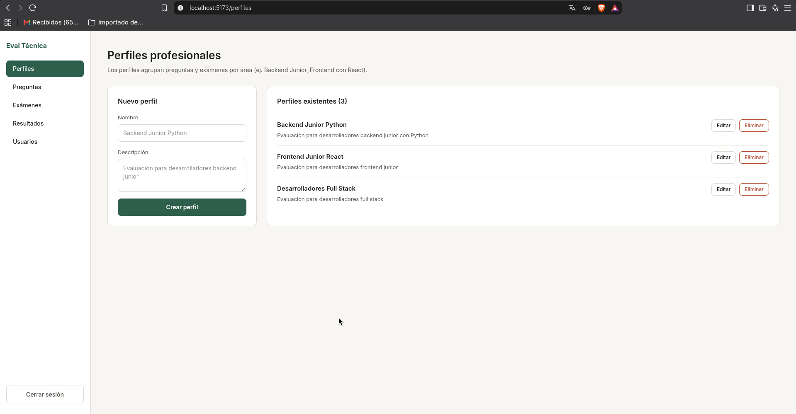
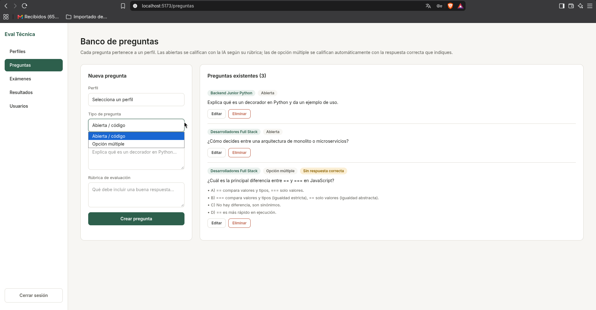
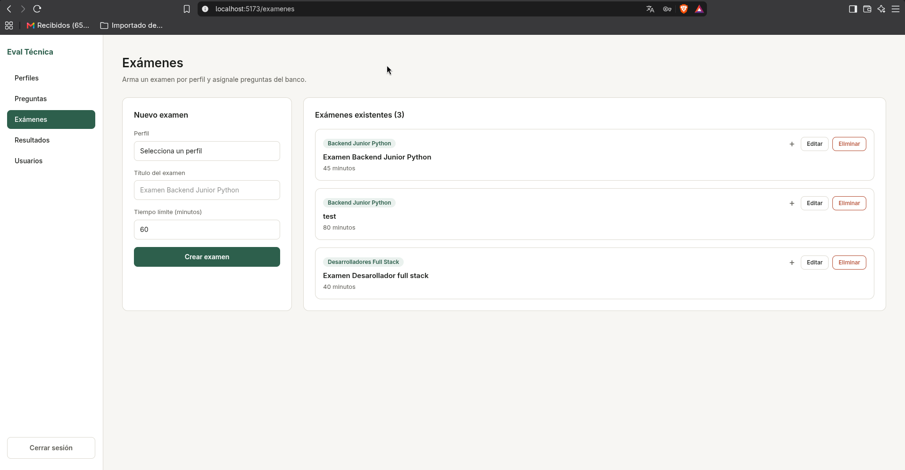
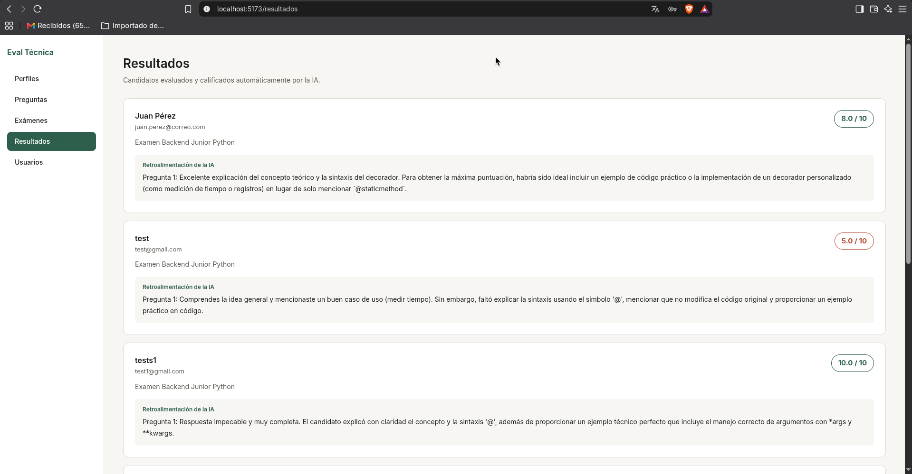
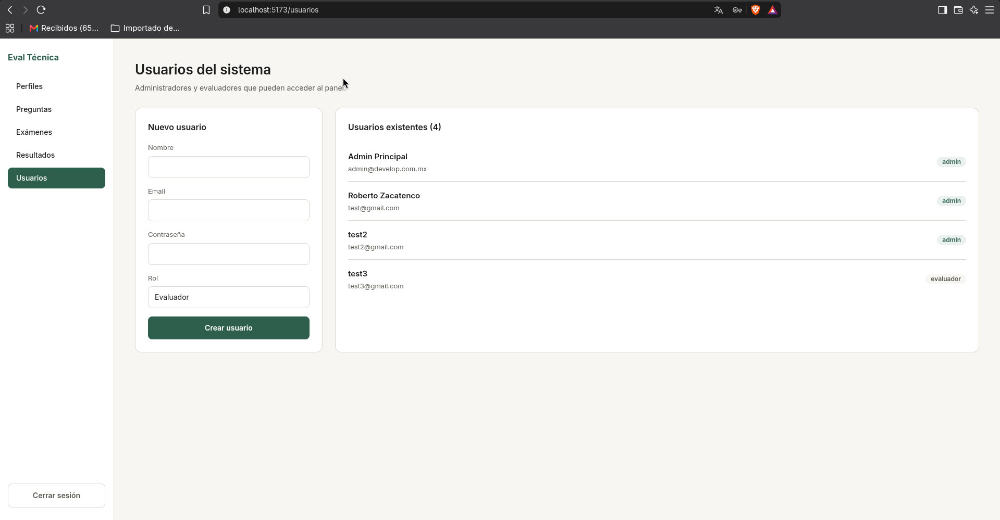
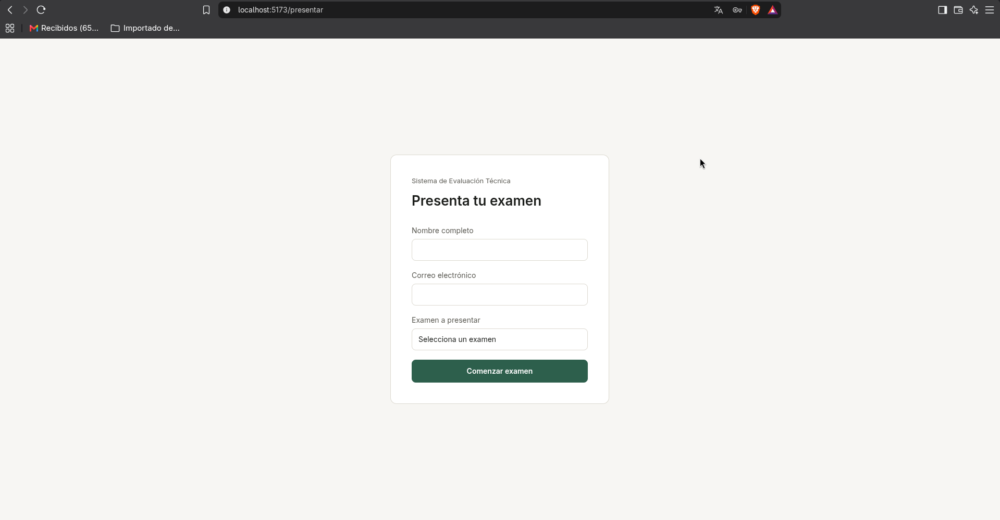
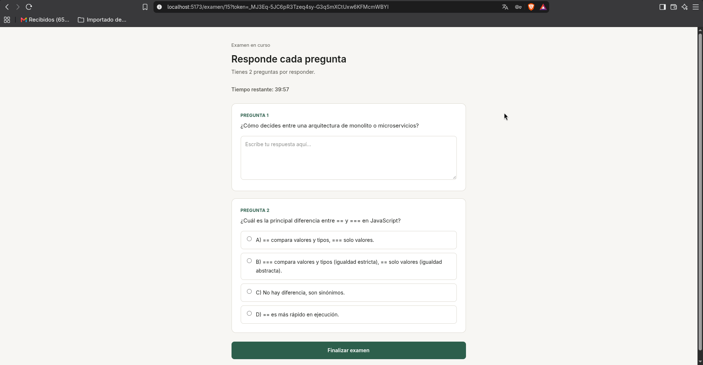
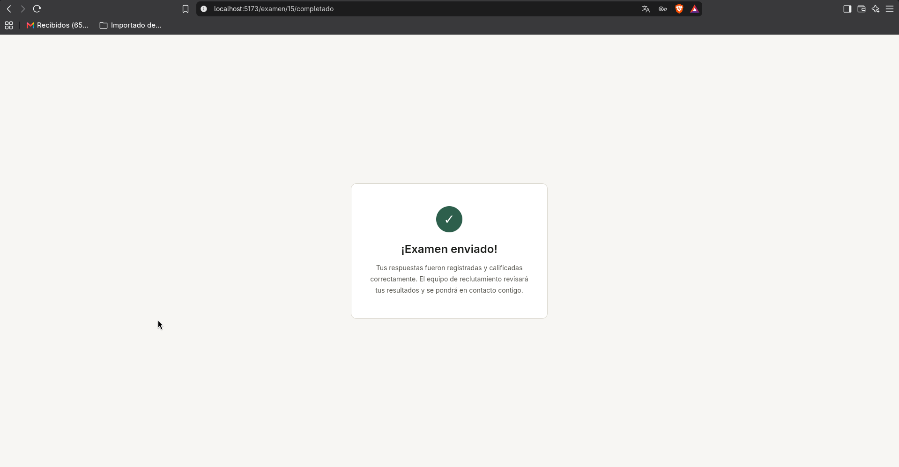

# Manual de Usuario — Sistema de Evaluación Técnica Automatizada para Candidatos

> **Empresa:** PluriOne S.A. de C.V. (Develop Talent & Technology)
> **Producto:** Sistema de Evaluación Técnica Automatizada (MVP)
> **Código:** PLU-MAN-2026-V1
> **Alumno:** Roberto Guadalupe Cruz Zacatenco · G19X-UPTAP-RGCZ-984

Este manual explica cómo usar el sistema de principio a fin, tanto para el **equipo de reclutamiento** (administradores y evaluadores) como para el **candidato** que presenta un examen.

---

## 1. ¿Quién usa qué?

| Rol | Qué puede hacer | Pantallas |
|---|---|---|
| **Administrador** | Todo lo del evaluador, más dar de alta y listar usuarios. | Perfiles, Preguntas, Exámenes, Resultados, Usuarios |
| **Evaluador** | Gestionar perfiles, preguntas y exámenes; revisar resultados. | Perfiles, Preguntas, Exámenes, Resultados |
| **Candidato** (sin cuenta) | Presentar un examen indicando nombre y correo. | Presentar examen, Responder examen, Confirmación |

---

## 2. Acceso al sistema

### 2.1 Iniciar sesión (panel)

1. Abre el panel en `http://localhost:5173/login`.
2. Escribe tu correo y contraseña.
3. Pulsa **Iniciar sesión**.

> Si vienes a presentar un examen (no a administrar), usa el enlace **«Vengo a presentar un examen»** de la pantalla de login.

> **Primer acceso:** el primer administrador se crea desde la terminal con `python crear_admin.py` (ver `README.md`). Los demás usuarios se dan de alta desde la pantalla **Usuarios**.

### 2.2 Cerrar sesión

Pulsa el botón **Cerrar sesión** del menú lateral.

---

## 3. Panel de administración

Al entrar, verás un menú lateral con las secciones: **Perfiles**, **Preguntas**, **Exámenes**, **Resultados** y (solo administrador) **Usuarios**.

### 3.1 Perfiles

Un **perfil** agrupa preguntas y exámenes por área (por ejemplo, «Backend Junior Python»).

- **Crear:** pulsa **Nuevo perfil**, escribe el nombre y una descripción, y guarda.
- **Editar:** pulsa el botón de editar del perfil.
- **Eliminar:** pulsa el botón de eliminar. El sistema lo impide si el perfil tiene preguntas asociadas y explica el motivo.

> 

### 3.2 Preguntas

El **banco de preguntas** guarda el enunciado, la rúbrica de evaluación y, si es de opción múltiple, las opciones y la respuesta correcta.

- **Crear:** elige el perfil, el tipo (`abierta` u `opción múltiple`), escribe el enunciado y la rúbrica.
  - Si es **opción múltiple**, agrega al menos 2 opciones y marca la correcta.
- **Editar / Eliminar:** con los botones de cada fila. No se puede eliminar una pregunta asignada a un examen.

> 

### 3.3 Exámenes

Un **examen** reúne preguntas de un perfil y define su **tiempo límite** (en minutos, 60 por defecto).

- **Crear:** elige el perfil, escribe el título y el tiempo límite.
- **Asignar preguntas:** abre el examen y pulsa **Agregar**; solo se ofrecen las preguntas del mismo perfil que aún no estén asignadas.
- **Quitar preguntas:** con el botón de quitar de cada pregunta asignada.
- **Eliminar:** no se permite si algún candidato ya lo presentó.

> 

### 3.4 Resultados

Aquí se revisa la **calificación** y la **retroalimentación** de la IA por candidato.

- Cada fila muestra: candidato, correo, examen, calificación total y retroalimentación.
- La nota se colorea: **verde** (≥ 8), **ámbar** (≥ 6) y **rojo** (< 6).

> 

### 3.5 Usuarios (solo administrador)

- **Crear:** escribe nombre, correo, contraseña y rol (`admin` o `evaluador`).
- **Listar:** muestra los usuarios del sistema.

> 

---

## 4. Flujo del candidato

El candidato **no necesita cuenta**. Presenta su examen desde un enlace público.

### 4.1 Presentar examen

1. Abre `http://localhost:5173/presentar`.
2. Escribe tu **nombre completo** y **correo electrónico**.
3. Elige el **examen** a presentar.
4. Pulsa **Comenzar examen**.

> Si el correo ya existe, el sistema reutiliza el candidato (no lo duplica).

> 

### 4.2 Responder el examen

- Verás las preguntas con un **contador regresivo** del tiempo límite.
- Las preguntas **abiertas** se responden en un campo de texto; las de **opción múltiple**, eligiendo una opción.
- Tus respuestas se **guardan automáticamente** al cambiar de opción o al salir del campo de texto, así que si recargas la página no las pierdes.
- Pulsa **Finalizar examen** cuando termines. El sistema valida que todas las preguntas estén respondidas.

> 

### 4.3 Al agotarse el tiempo

- Al llegar a cero, el sistema **envía automáticamente** las respuestas contestadas (incluida la que aún estás escribiendo) y las califica.
- Si no contestaste nada, el intento se califica con **0**.
- Si el servicio de IA está saturado, verás un mensaje y podrás **reintentar** con el botón **Finalizar examen** (aunque falten preguntas por responder).

### 4.4 Confirmación

Al terminar verás una pantalla de **confirmación de envío**. El candidato **no ve su calificación**; solo el equipo de reclutamiento la revisa en **Resultados**.

> 

---

## 5. Preguntas frecuentes

**¿El candidato puede ver su nota?**
No. Solo ve la confirmación de envío. La nota y la retroalimentación las revisa el evaluador en el panel de Resultados.

**¿Qué pasa si el candidato recarga la página a mitad del examen?**
Sus respuestas ya guardadas se recuperan y el contador sigue corriendo desde el inicio del intento.

**¿Qué pasa si el examen no tiene preguntas?**
El candidato ve un mensaje claro de «examen no disponible» y debe contactar al equipo de reclutamiento.

**¿Puedo eliminar un perfil, pregunta o examen que ya se usa?**
No. El sistema lo impide y explica el motivo para no dejar datos huérfanos.

---

## 6. Referencias

- **README.md** — instalación y puesta en marcha.
- **docs/PRD.md** — requerimientos y decisiones técnicas.
- **docs/MVP.md** — alcance y estado del MVP.
- **API interactiva** — `http://127.0.0.1:8000/docs` (Swagger).
